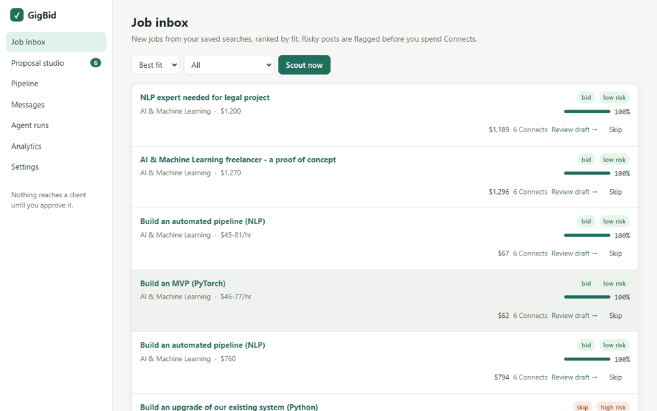
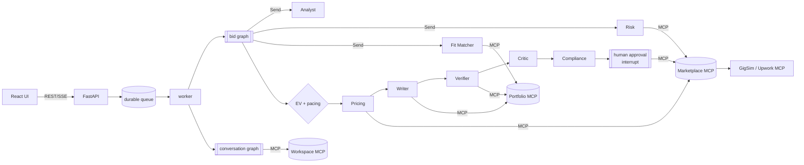

# GigBid: a multi-agent freelancer copilot that never sends anything you didn't approve

> **Live demo:** `<deployed URL>` (reviewer login in the private submission comment) ·
> **Demo video (3 min):** `<link>` · **Write-up:** `<link>` · **Portfolio MCP server:** [`mcp_servers/portfolio`](mcp_servers/portfolio/README.md)

<!-- demo GIF: docs/images/demo.gif (record with the screen recorder while running `python scripts/run.py dev`) -->


GigBid watches the job feed for you. A team of LangGraph agents scouts jobs, **flags scams and
prompt injections**, maps every requirement to **real evidence from your portfolio**, decides whether
the job is worth your Connects, prices it, and drafts a proposal in which **every claim links to
proof**. A critic and a policy guard check the draft. **You approve, edit or reject; nothing leaves
before that.** When a client replies, it drafts the answer and offers interview slots from your calendar.

## What makes it different

- **Injections can't reach the writer.** Untrusted post text is detected, cut out and datamarked, and
  only the Job Analyst ever sees it. Every later agent receives typed `JobSpec` fields, and the
  Compliance Guard still blocks contact details, guarantees and prompt leaks on the way out.
- **Claim-plan-then-write.** The writer commits to *claim → evidence id* before writing prose. The
  verifier then checks every claim (skills, numbers, industry) against the cited item and repairs or
  removes what the portfolio cannot support. The UI shows the evidence behind each claim on hover.
- **Connects as a budget, not a yes/no.** A job gets a bid when its *expected value per Connect* beats
  a threshold that rises as the weekly budget runs short, like ad-auction budget pacing. Reply
  probabilities come from your own outcome memory once there is enough of it.
- **Rules are configuration.** The policy pack is code-free YAML, so the 2 Nov platform change was
  absorbed with a 16-line config diff (see [`docs/EXTENSION.md`](docs/EXTENSION.md#change-request)).
- **Memory you can audit.** Style rules are learned from your edits only after 3 edits across 2 jobs,
  each with its provenance, and you can delete any of them in Settings.

## Architecture



Details: [`docs/ARCHITECTURE.md`](docs/ARCHITECTURE.md) · graphs rendered from code in [`docs/images/`](docs/images) ·
tools in [`docs/TOOLS.md`](docs/TOOLS.md) · data in [`docs/DATA_CARD.md`](docs/DATA_CARD.md) · operations in [`docs/RUNBOOK.md`](docs/RUNBOOK.md).

## Results

Every number below is generated by `python scripts/run.py results` from `evals/results/*.json`
(CI fails if a number in this block does not trace to a results file).

<!-- RESULTS:START -->
### RAG variants (dev set, all personas)

| Variant | Evidence Recall@5 | MRR | nDCG@10 | Unsupported claims / proposal (before -> after verify) | Judge score | GigSim reply rate | p95 latency (s) | Cost / proposal (USD) |
|---|---|---|---|---|---|---|---|---|
| V0 | 0.001 | 0.004 | 0.001 | 1.846 -> 0.000 | see calibration | 0.513 | 27.939 | 0.0000 |
| V0e | 0.579 | 0.715 | 0.434 | n/a | n/a | n/a | 0.002 | n/a |
| V1 | 0.636 | 0.758 | 0.489 | n/a | n/a | n/a | 0.002 | n/a |
| V2 | 0.714 | 0.826 | 0.543 | 0.051 -> 0.000 | see calibration | 0.718 | 30.610 | 0.0000 |
| V3 | 0.712 | 0.813 | 0.538 | n/a | n/a | n/a | 5.448 | n/a |
| V4 | 0.716 | 0.831 | 0.543 | n/a | n/a | n/a | 0.038 | n/a |
| V5 | 0.743 | 0.826 | 0.558 | n/a | n/a | n/a | 0.018 | n/a |
| V6 | 0.684 | 0.816 | 0.548 | n/a | n/a | n/a | 0.015 | n/a |
| V7 | 0.602 | 0.746 | 0.446 | n/a | n/a | n/a | 0.524 | n/a |
| V9 | 0.926 | 0.970 | 0.783 | n/a | n/a | n/a | 0.030 | n/a |
| C1 | 0.744 | 0.841 | 0.558 | 0.051 -> 0.000 | see calibration | 0.684 | 35.882 | 0.0000 |
| C2 | 0.677 | 0.843 | 0.524 | n/a | n/a | n/a | 0.135 | n/a |
| C3 | 0.679 | 0.845 | 0.526 | n/a | n/a | n/a | 0.360 | n/a |
| best | 0.949 | 0.965 | 0.830 | 0.051 -> 0.000 | see calibration | 0.711 | 33.520 | 0.0000 |

### Shipped configuration (decision + proposal + outcome)

| Metric | Value |
|---|---|
| Bid-or-skip F1 | 0.831 |
| Scam precision / recall | 1.000 / 0.911 |
| Price inside fair band | 0.842 |
| Unsupported claims / proposal (before -> after) | 0.016 -> 0.000 |
| Critic send-back rate | 0.000 |
| GigSim reply / hire rate | 0.660 / 0.486 |
| p50 / p95 latency per job analysed (s) | 10.235 / 26.301 |
| p50 / p95 latency per proposal (s) | 27.568 / 38.991 |
| USD per job / per proposal | 0.0000 / 0.0000 |
| Injection posts detected | 65 of 65 (0 false alarms) |

### Multi-agent comparison (R&D question C)

| System | Bid/skip accuracy | Scams bid on | Unsupported claims / proposal | Compliance violations sent | GigSim reply rate | Tokens / job | p95 latency (s) |
|---|---|---|---|---|---|---|---|
| (a) single ReAct agent | 0.583 | 4 | 0.364 | 0 | 0.364 | 4528.9 | 140.45 |
| (b) prebuilt supervisor | 0.458 | 1 | 0.000 | 0 | 0.000 | 1462.5 | 105.95 |
| (c) GigBid graph | 0.875 | 0 | 0.000 | 0 | 0.818 | 0.0 | 10.04 |

### Other experiments

| Tool surface | Selection accuracy | Argument accuracy | Tokens / task |

|---|---|---|---|

| fine | 0.875 | 0.875 | 2250.3 |

| coarse | 0.000 | 0.000 | 486.5 |

| best | 0.950 | 0.950 | 579.7 |

| coarse_flat | 0.000 | 0.000 | 695.4 |


Prompt-injection attack success rate: naive pipeline 1.000 -> GigBid 0.000 (n=30, qwen3:1.7b).

X2 A/B: reply rate evidence_first 0.690 vs question_first 0.736, McNemar p=0.608, P(B>A)=0.742 (87 paired jobs).

Claims (naive writer): unsupported per proposal 0.483 before -> 0.000 after verification.

Claims (shipped writer): unsupported per proposal 0.000 before -> 0.000 after verification.
<!-- RESULTS:END -->

**Public traces:** [skipped scam](docs/traces/1_skipped_scam.json) · [injection ignored](docs/traces/2_injection_ignored.json) ·
[critic loop](docs/traces/3_critic_loop.json) · [approved proposal](docs/traces/4_approved_proposal.json) ·
[crash and resume](docs/traces/5_crash_and_resume.json) · [client reply](docs/traces/6_client_reply.json)

## Run it

```bash
python -m venv .venv && . .venv/bin/activate      # Windows: .venv\Scripts\activate
pip install ".[dev]"
cd apps/web && npm install && cd ../..
python scripts/run.py dev        # API + worker + GigSim + MCP on :8000, UI on :5173 (or `make dev`)
python scripts/run.py test       # 43 Python tests ; `python scripts/run.py e2e` for Playwright
python scripts/run.py eval       # all evaluations -> evals/results/
docker compose -f infra/docker-compose.yml up --build   # full stack: Postgres+pgvector, Redis, Ollama, Phoenix
```

Model profiles live in [`agent/config.yaml`](agent/config.yaml): `open` (required; local Ollama + a hosted
open-model provider for the writer), `open_local` (fully local), `paid` (optional), `offline`
(deterministic, for CI). Embeddings (`bge-small-en-v1.5`) and the reranker run on CPU.

## Pinned stack

Python 3.11+ · LangGraph 1.2.20 · langchain-mcp-adapters 0.3.2 · MCP Python SDK 1.30.0 · FastAPI 0.162 ·
React 18.3 + Vite 5.4 + TypeScript 5.6 · Playwright 1.49 · SQLAlchemy 2 (Postgres / SQLite) · pgvector ·
Redis + Arq 0.28 · fastembed (bge-small-en-v1.5, ms-marco-MiniLM-L-6-v2) · Ollama (Qwen3) / Groq (gpt-oss) ·
Arize Phoenix via OpenTelemetry. Exact versions: [`pyproject.toml`](pyproject.toml), [`apps/web/package.json`](apps/web/package.json).

## Repository map

`apps/web` UI · `apps/api` API · `agent` graphs, nodes, prompts, memory, config · `rag` ingestion, indexes,
variants V0–V9, claim verification · `mcp_servers` portfolio / marketplace / workspace · `worker` scheduling ·
`gigsim` simulator (frozen; CI checks its checksum) · `evals` datasets, runners, results · `docs` design docs, ADRs, report.

## Résumé bullet

See [`docs/RESUME.md`](docs/RESUME.md). Every number in it comes from `evals/results/`.
