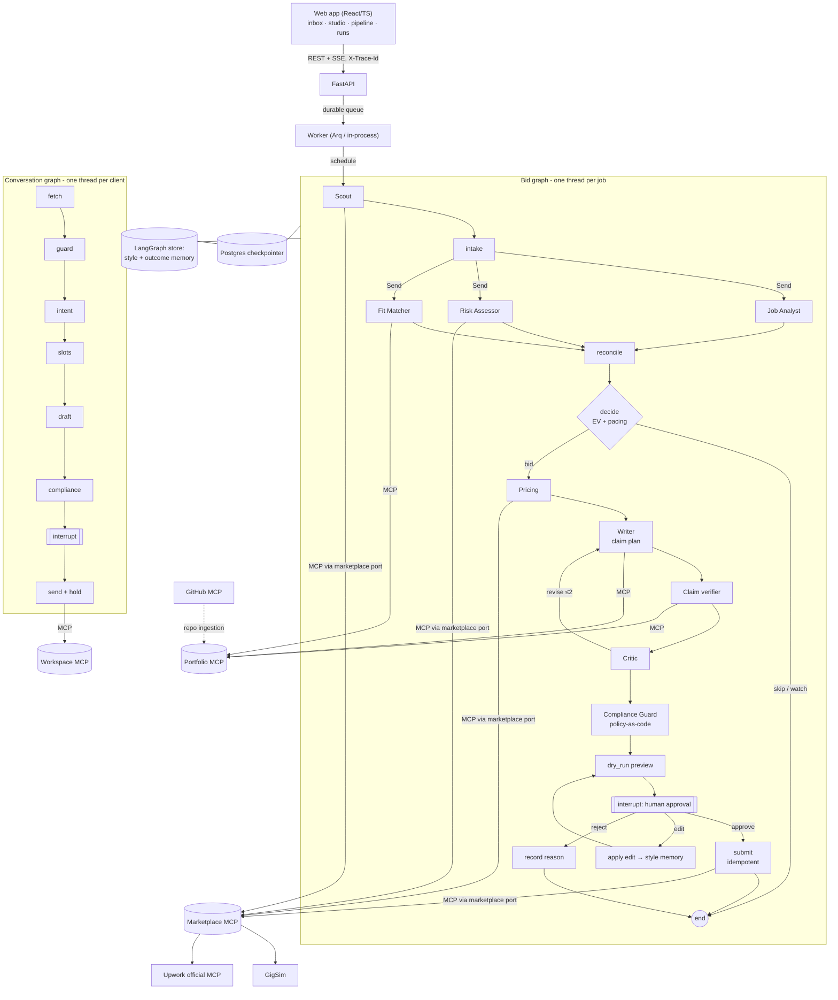

# Architecture

Rendered from code: `docs/images/bid_graph.mmd` and `docs/images/conversation_graph.mmd`
(produced by `scripts/demo.py` from `graph.get_graph().draw_mermaid()`).

## Why each agent exists

| Agent | Why it is a separate step | Model route |
|---|---|---|
| Scout | Scheduling, dedup and rate discipline are not LLM work. It is the only producer of jobs, so idempotency lives in one place. | none |
| Job Analyst | The **only** consumer of raw post text, apart from Risk. It turns untrusted text into a typed `JobSpec`, and everything downstream reads typed fields (injection quarantine). | small (LLM proposes requirements; taxonomy + post text dispose) |
| Risk Assessor | Needs marketplace history the analyst must not touch, and must be able to veto everything. Deterministic signals run first; the LLM is asked only in the grey zone (0.25–0.6). | small |
| Fit Matcher | Retrieval-heavy and parallel. It decomposes requirements itself (speculative matching) so it need not wait for the Analyst; `reconcile` closes the gap afterwards. | none (RAG) |
| decide | Bid/watch/skip is an expected-value decision under a weekly Connects budget, not a prompt. | none |
| Pricing Strategist | Market percentiles, client spend, floor and ceiling. Pure arithmetic, auditable. | none |
| Proposal Writer | Claim-plan-then-write: the plan (claim → evidence id) is fixed before prose, so grounding is checkable. | strongest affordable |
| Claim verifier | R5 must be measured, so it is a separate step with before/after counts. | deterministic (optional NLI) |
| Critic | Quality (personalisation, length, screening answers) is different from truth (verifier) and from rules (compliance). It may send back at most twice. | strong |
| Compliance Guard | Policy pack as code. A new platform rule is YAML, not a prompt edit. It can block. | none |
| Client Liaison | Different lifecycle (per conversation), different tools (calendar), same approval gate. | small (intent) + strong (reply) |

## The marketplace port

`agent/marketplace_port.py` defines one interface. `GigSimPort` talks to our Marketplace
MCP server, and `UpworkLivePort` talks to Upwork's official MCP server with OAuth 2.1 and
discovers its tool names at connect time. `marketplace.mode` in config picks one; no node
imports either adapter.

## State vs execution trace vs long-term memory

| | Where | What | Written by |
|---|---|---|---|
| **State** | LangGraph checkpoint (Postgres/SQLite) | what this job or conversation needs now: job, analyses, evidence, decision, price, drafts, critiques, approvals, budget counters | nodes (reducers on parallel or loop keys) |
| **Execution trace** | `spans` table + Phoenix (OTLP) | every node, LLM call (tokens, USD) and tool call (masked args/result) under one trace id | `common/tracing.py`, `ToolHub` |
| **Long-term memory** | LangGraph store | only promoted knowledge: style rules (S1 ≥3 edits across ≥2 jobs; S2 demotion on contradiction), per-category outcome posteriors (O1 Beta update from validated marketplace events; O2 used after ≥5 samples) | `agent/memory/promotion_rules.py` only |

Raw tool output never reaches memory: outcome records are validated (known event type,
known proposal, de-duplicated) and aggregated before use.

## Durability and failure handling

- Postgres checkpointer: approvals survive API restarts, and the UI reads pending
  interrupts from checkpoints.
- Exactly-once: idempotency keys derived from (thread, draft version, text hash), replayed
  by both the MCP server and GigSim.
- Per-node `RetryPolicy` and `timeout`; a fallback model chain (configured → fallback →
  deterministic) for every LLM node.
- Step and token budgets per thread move a thread to `needs_attention`.
- Dead letter: a work item that fails 3 times is parked as `dead_letter`, visible in the UI.
- Degraded mode: a circuit breaker per MCP server, `queued_degraded`, automatic re-queue.
