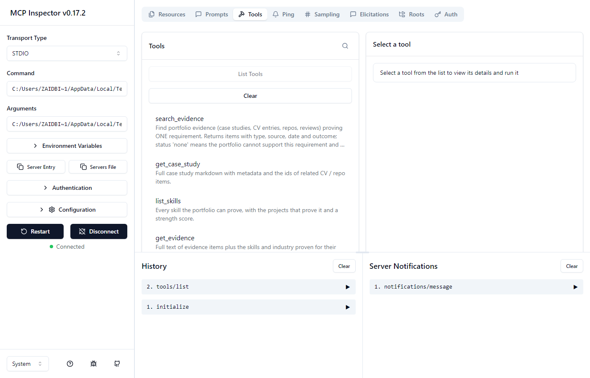
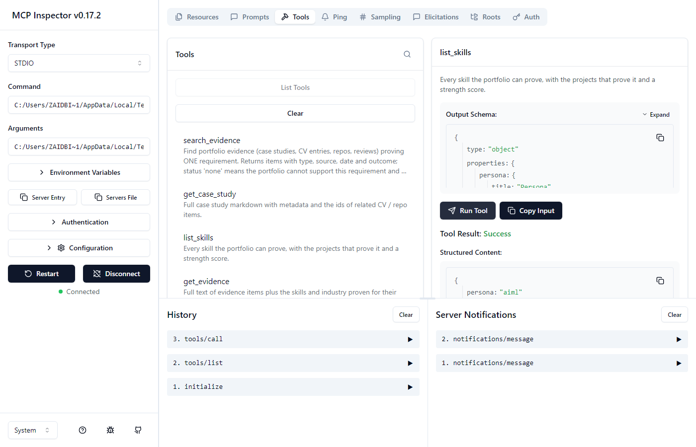
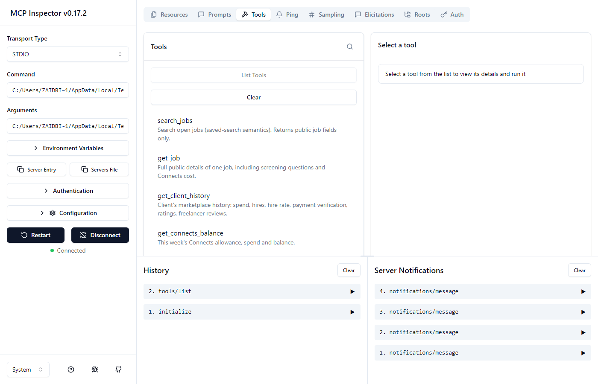
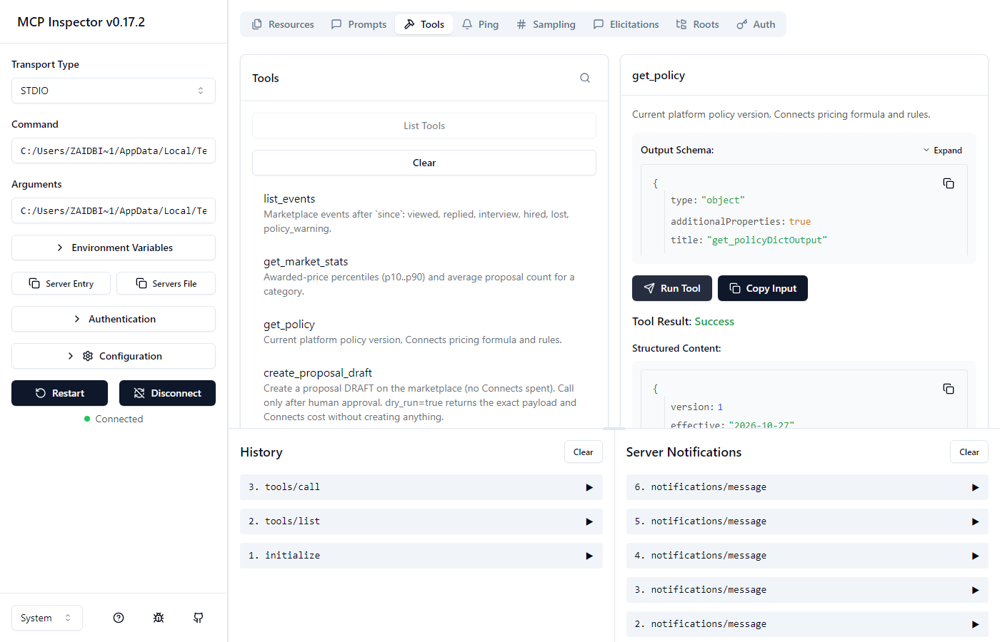
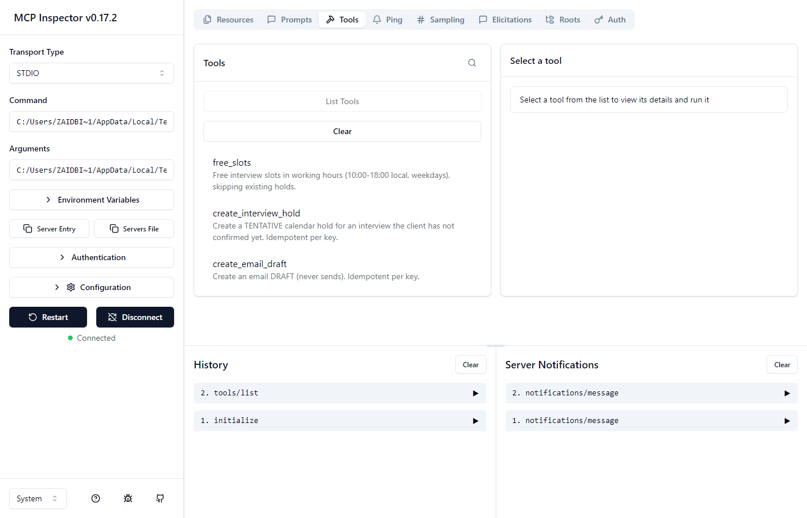
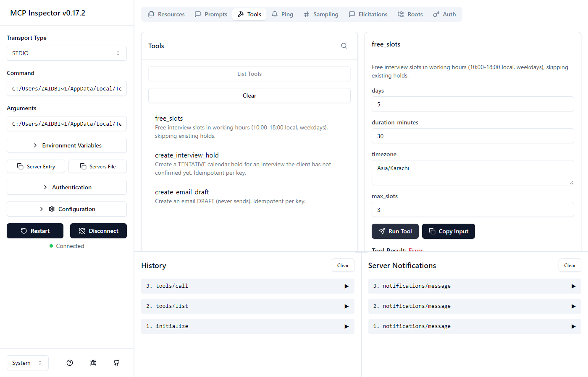

# Tool surface (MCP)

Agents never call GigSim, Upwork, a database or a file directly: every capability is an MCP
tool with a schema, an owner and a test. Schemas are snapshot-tested
(`tests/contract/snapshots/*.json`), so CI fails when a signature changes unintentionally.

**Auth:** our three servers run over Streamable HTTP behind a shared bearer token
(`MCP_SERVER_TOKEN`). The calling user, persona and trace id travel in the MCP request
`_meta`, and the marketplace server resolves the user's GigSim/Upwork token from the
encrypted token store itself. Tokens never pass through the agent. In tests and
single-container deployments the same servers are reached through in-memory MCP sessions,
which is still the full protocol.

## GigBid servers

| Tool | Server | R/W | readOnly | destructive | idempotent | Auth | Owner / test |
|---|---|---|---|---|---|---|---|
| `search_evidence(requirement, k, filters)` | portfolio | read | ✔ | ✘ | ✔ | bearer + `_meta.persona` | portfolio · `mcp_servers/portfolio/tests` |
| `get_case_study(id)` | portfolio | read | ✔ | ✘ | ✔ | bearer | portfolio |
| `list_skills()` | portfolio | read | ✔ | ✘ | ✔ | bearer | portfolio |
| `get_evidence(item_ids)` | portfolio | read | ✔ | ✘ | ✔ | bearer | portfolio (used by the verifier) |
| `find_winning_proposals(job_summary, k)` | portfolio | read | ✔ | ✘ | ✔ | bearer | portfolio (tone only, never proof) |
| `have_i_done(skill, industry)` | portfolio | read | ✔ | ✘ | ✔ | bearer | portfolio (skill graph, V9) |
| resources `portfolio://case/{id}`, `portfolio://proposal/{id}`, `portfolio://repo/{id}`, `portfolio://cv` | portfolio | read | - | - | - | bearer | portfolio |
| prompts `answer_screening_question`, `skills_gap_check`, `write_grounded_cover_letter` | portfolio | - | - | - | - | bearer | portfolio |
| `search_jobs(query, category, skills, since, limit)` | marketplace | read | ✔ | ✘ | ✔ | bearer + per-user GigSim token | marketplace · `mcp_servers/marketplace/tests` |
| `get_job(job_id)` | marketplace | read | ✔ | ✘ | ✔ | " | marketplace |
| `get_client_history(client_id)` | marketplace | read | ✔ | ✘ | ✔ | " | marketplace |
| `get_connects_balance()` | marketplace | read | ✔ | ✘ | ✔ | " | marketplace |
| `list_threads()` / `list_messages(thread_id)` | marketplace | read | ✔ | ✘ | ✔ | " | marketplace |
| `list_events(since)` | marketplace | read | ✔ | ✘ | ✔ | " | marketplace |
| `get_market_stats(category, budget_type)` | marketplace | read | ✔ | ✘ | ✔ | " | marketplace |
| `get_policy()` | marketplace | read | ✔ | ✘ | ✔ | " | marketplace |
| `create_proposal_draft(proposal{…, idempotency_key, dry_run})` | marketplace | **write** | ✘ | ✘ | ✔ (per key) | " + human approval in GigBid | marketplace |
| `submit_proposal(submission{proposal_id, job_id, idempotency_key, dry_run})` | marketplace | **write** (spends Connects) | ✘ | ✔ | ✔ (per key) | " + approval | marketplace |
| `send_message(message{thread_id, text, idempotency_key, dry_run})` | marketplace | **write** (irreversible) | ✘ | ✔ | ✔ (per key) | " + approval | marketplace |
| `free_slots(days, duration_minutes, timezone, max_slots)` | workspace | read | ✔ | ✘ | ✔ | bearer | workspace · `mcp_servers/workspace/tests` |
| `create_interview_hold(hold{start, duration, title, idempotency_key})` | workspace | write (tentative) | ✘ | ✘ | ✔ | bearer + approval | workspace |
| `create_email_draft(draft{to_name, subject, body, idempotency_key})` | workspace | write (draft, never sends) | ✘ | ✘ | ✔ | bearer | workspace |

Write-tool guarantees: Pydantic input schemas with real constraints (lengths, ranges, key
pattern) and declared output schemas (`WriteResult`). `dry_run=true` returns exactly what
would be sent plus the Connects cost and balance afterwards, and the approval screen shows
this. A retried call with the same `idempotency_key` replays the stored result, both in the
server and in GigSim, so it never submits twice or spends Connects twice. Every write is
appended to a hash-chained audit log with user, tool, masked arguments, result and trace id
(`AuditLog.verify()` detects tampering).

`send_message` is marked `destructiveHint=true` even though it deletes nothing, because
its effect on the client is irreversible. Hosts should therefore treat it as a confirm-first action.

## Per-agent allowlists (A6)

Defined in `agent/config.yaml → mcp.allowlists` and enforced by `ToolHub.call(..., agent=)`
(`ToolNotAllowed`):

| Agent | Tools |
|---|---|
| Scout | search_jobs, get_job |
| Risk Assessor | get_client_history |
| Fit Matcher | search_evidence, list_skills, have_i_done, find_winning_proposals |
| Pricing / decision | get_market_stats, get_connects_balance, get_policy |
| Proposal Writer | search_evidence, get_case_study, get_evidence, find_winning_proposals |
| Verifier | search_evidence, get_evidence |
| Critic | search_evidence, get_evidence |
| Client Liaison | list_threads, list_messages, send_message, free_slots, create_interview_hold, create_email_draft |
| Submitter (after approval only) | create_proposal_draft, submit_proposal |
| Job Analyst, Compliance Guard | none |

## Third-party servers (A5)

| Server | Used for | Trust rationale |
|---|---|---|
| **Upwork official MCP** (`https://mcp.upwork.com/mcp`) | live mode: job search, proposal and message drafts | First-party server operated by the platform itself, with OAuth 2.1 scoped to the user. Every write is a platform draft the user confirms on Upwork, so it is the only sanctioned automation path. |
| **GitHub MCP** (`@modelcontextprotocol/server-github`) | repo ingestion for the portfolio (README + code) | Reference server from the MCP project with a read-only use (get file contents/list repos). It runs locally with a fine-grained PAT limited to public repo read. |

Resilience (A6): every call has a per-server timeout (portfolio 120 s, marketplace 20 s),
bounded retries with exponential backoff and jitter, and a circuit breaker per server
(3 failures open it for 30 s). With the marketplace down, threads move to
`queued_degraded`, `/api/health` reports `degraded`, the UI shows the
"Marketplace unavailable" banner, and the scheduler re-queues the work once the breaker
closes. Code: `agent/mcp_client.py`, `agent/runtime.py`, `worker/engine.py::tick`.

## MCP Inspector

All three servers connected in the official MCP Inspector (v0.17.2) over stdio via `scripts/run_mcp.py`:

| Server | Tool list | A tool call |
|---|---|---|
| portfolio |  |  |
| marketplace |  |  |
| workspace |  |  |

