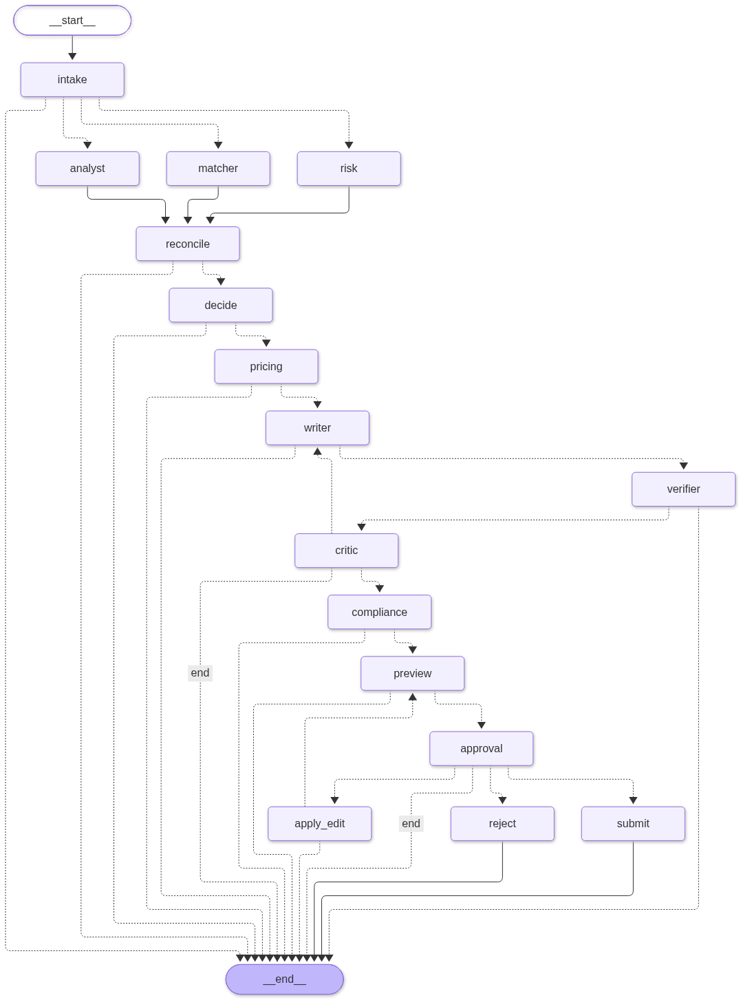

# GigBid - R&D design review

AI-4016 R&D assignment · individual · Every number below is filled at build time from
`evals/results/*.json` (`python scripts/build_report.py`); file names are cited inline.
Repository commit history and traces (`docs/traces/`) back every claim.

## 1. Problem and constraints

A freelancer's week has four expensive steps: scanning feeds, judging whether a job is worth the
Connects, writing a specific proposal, and keeping conversations moving. GigBid automates
discovery, assessment and drafting. **The freelancer makes every decision that leaves the system.**

**Never automated (enforced in code):** submitting a proposal, sending a message, spending Connects
(LangGraph `interrupt()` in both graphs; no API path resumes a thread without an approval body);
claiming experience the portfolio cannot support (claim verifier + compliance rule P2); any
off-platform contact, payment or guarantee (policy pack); any read faster than the declared
schedule (rate limiter + RUNBOOK). The per-user autonomy setting can auto-*skip* clearly low-fit
jobs, never auto-send.

**Declared budgets** (`agent/config.yaml → budgets.declared`): p95 latency 20 s per job analysed
and 60 s per proposal; USD 0.002 per job analysed and 0.01 per proposal; 40 steps and 60k tokens
per thread (exceeding either moves the thread to *needs_attention*).

**Data.** The starter kit was not distributed, so `data/generator` builds a deterministic stand-in
world with the brief's properties and exact gold labels (`docs/DATA_CARD.md`). GigSim's client model
rewards must-have coverage and specificity, penalises generic openings and over-budget bids, and
exposes fabricated experience at interview. Reply rates are comparable only within GigSim.

## 2. Architecture

Two hand-written LangGraph `StateGraph`s (rendered from code: `docs/images/bid_graph.png`,
`conversation_graph.png`). In the **bid graph**, `intake` fans out with `Send` to Job Analyst, Risk
Assessor and Fit Matcher in parallel. A `reconcile` join searches evidence for any requirement the
Analyst found that the Matcher's own decomposition missed. Then come `decide` (skip / watch / bid),
Pricing, Writer, claim Verifier, Critic (≤ 2 send-backs), Compliance, `dry_run` preview and the
`interrupt()` approval (approve → idempotent submit; edit → diff, style memory, compliance re-check,
re-approval; reject → reason). The **conversation graph** (one thread per client) runs fetch, injection
guard, intent, interview slots or negotiation (walk-away rules), reply, compliance and approval.

**Marketplace port.** One interface (`agent/marketplace_port.py`) with two adapters: GigSim (our
Marketplace MCP server) and live Upwork (official MCP server via `MultiServerMCPClient`, OAuth 2.1 +
PKCE, tokens encrypted per user, tool names discovered at connect time). `marketplace.mode` switches
them; no node imports an adapter.

**MCP surface.** Portfolio (read), Marketplace (read + idempotent, `dry_run`-able writes with
annotations), Workspace (calendar slots, tentative holds, email drafts), plus Upwork and GitHub
(`docs/TOOLS.md`). There are per-agent allowlists, per-server timeouts, retries with backoff, and a
circuit breaker that drives degraded mode.

**State, trace, memory are separate.** Typed state (TypedDict + reducers on every parallel or loop key;
Pydantic hand-offs `JobSpec`, `RiskReport`, `FitReport`, `BidDecision`, `PriceQuote`, `ProposalDraft`,
`Critique`, `ComplianceVerdict`) lives in the Postgres checkpointer. The execution trace (every node,
LLM call with tokens and USD, tool call with masked args and result) lives in the spans table and
Phoenix. Long-term memory lives in the LangGraph store and is written **only** by promotion rules:
style rule S1 (≥ 3 edits across ≥ 2 jobs within 60 days; demoted on contradiction) and outcome rules
O1/O2 (Beta posteriors per category from validated marketplace events; used after ≥ 5 samples).

**Why each agent exists** (`docs/ARCHITECTURE.md`): each one owns either a trust boundary (Analyst:
the only reader of untrusted text; Compliance: the only rule interpreter), a different data source
(Risk: client history; Matcher: portfolio), or a different cost/latency class (deterministic
decide/pricing vs. strong-model writer/critic).

## 3. R&D question A - tool granularity

**Hypothesis.** Coarse tools (`marketplace(action, args)`) cut prompt tokens but cost argument
accuracy. Exposing only role-relevant fine-grained tools with "use when / do not use for"
descriptions beats both.

**Setup.** 40 tasks with known correct calls (`evals/runners/tool_granularity.py`), the same model
(n/a), and three surfaces: *fine* (all 19 tools), *coarse*
(3 tools), *best* (role allowlist + rewritten descriptions). We record one tool call per task.

| Surface | Tool selection | Argument accuracy | Tokens / task |
|---|---|---|---|
| fine | n/a | n/a | n/a |
| coarse | n/a | n/a | n/a |
| best | n/a | n/a | n/a |

**Conclusion.** <!--A-CONCLUSION-->

## 4. R&D question B - retrieval, verification, what ships

**Hypothesis (stated before running).** "Hybrid BM25 + dense raises evidence Recall@5 by ≥ 10
points over naive dense, and a cross-encoder adds ≥ 3 more at k = 5."

**Results** (`rag_retrieval.json`, every dev job with gold evidence, n = 494):

| Variant | Recall@5 | MRR | nDCG@10 | p95 s |
|---|---|---|---|---|
| V0 naive dense (all docs) | 0.001 | 0.004 | 0.001 | 0.001 |
| V0e control: naive dense, evidence only | 0.579 | 0.715 | 0.434 | 0.002 |
| V1 requirement decomposition | 0.636 | 0.758 | 0.489 | 0.002 |
| V2 hybrid BM25 + dense (RRF) | 0.714 | 0.826 | 0.543 | 0.015 |
| V3 + cross-encoder rerank | 0.712 | 0.813 | 0.538 | 5.448 |
| V4 outcome-aware | 0.716 | 0.831 | 0.543 | 0.038 |
| V5 multi-vector | 0.743 | 0.826 | 0.558 | 0.018 |
| V6 contextual | 0.684 | 0.816 | 0.548 | 0.015 |
| V7 HyDE-lite | 0.602 | 0.746 | 0.446 | 0.524 |
| V8 corrective (LangGraph) | n/a | n/a | n/a | n/a |
| V9 skill graph | 0.926 | 0.970 | 0.783 | 0.030 |
| C5 = V2 + V5 + V4 + V9 (round 1 pick) | 0.933 | 0.968 | 0.802 | 0.073 |
| **shipped** = C5 − dense | **0.949** | 0.965 | **0.830** | 0.019 |

The hypothesis was **half right**. On the clean index, hybrid raised Recall@5 from
0.579 (V0e) to 0.714, but the reranker added
nothing at k = 5 on this corpus while costing seconds on CPU. Two results were larger than anything hypothesised:
(1) **corpus contamination**. Naive RAG retrieved past proposals (they look like job posts) instead of
evidence; the V0 → V0e control isolates it. (2) **Structure beats similarity**: the skill graph alone
outperforms every text ranker. Caveat: gold relevance is skill-defined, which favours a skill-aware
retriever, so we also check end to end below.

**Ablation of the shipped pipeline** (`ablation.json`; round 1 in `ablation_round1.json`):
removing the graph → Recall@5 0.836;
removing BM25 → 0.954;
removing multi-vector → 0.936;
removing outcome boost → 0.947;
adding the dense ranking back → 0.933.
By persona (shipped): aiml 0.943, web
0.960, data 0.942.
By job type: vague posts 0.936, implied skills
0.938, ≥ 4 requirements 0.962.

**Claim verification** (`claims_eval.json`, same jobs and evidence). The naive "experience list"
writer averages n/a unsupported claims per proposal
before verification and n/a after. The shipped
claim-plan writer averages n/a →
n/a, with a partial-claim rate of
n/a (partials are repaired by deleting the unsupported
skill, number or industry). On the full dev run (`decision_eval.json`) the rate is
n/a → n/a.

**Retrieval vs reply rate** (`gigsim_outcomes.json`, the same n/a gold-bid jobs per variant):

| Variant | Reply rate | Hire rate | Unsupported / proposal (before → after) | p95 s |
|---|---|---|---|---|
| V0 | n/a | n/a | n/a → n/a | n/a |
| V2 | n/a | n/a | n/a → n/a | n/a |
| C1 | n/a | n/a | n/a → n/a | n/a |
| shipped | n/a | n/a | n/a → n/a | n/a |

<!--B-OUTCOME-->

**Judge calibration.** The rubric judge (`agent/prompts/judge.md`) is used only after calibration
against 30 human labels (`evals/runners/judge_calibration.py`). Cohen's κ =
n/a (n = n/a). Judge scores are not used
for any decision until κ ≥ 0.4.

**What ships.** BM25 + skill graph + multi-vector + outcome boost (no dense ranking, no reranker),
plus claim verification on every draft. It is the best recall at the lowest latency, and the
components we dropped were measured, not assumed, to be neutral or harmful here (ADR 0003).

## 5. R&D question C - single agent vs supervisor vs graph

Same jobs (1 per persona, half gold-bid), same LLM
(qwen3:1.7b) for (a), (b) and the LLM nodes of (c); same verifier and policy pack
applied to every final proposal (`multiagent_compare.json`).

| System | Bid/skip acc. | Scams bid on | Unsupported / proposal | Violations sent | Reply rate | Tokens / job | p95 s |
|---|---|---|---|---|---|---|---|
| (a) one ReAct agent, all tools | 1.000 | 0 | 0.333 | 0 | 0.333 | 1854 | 106.5 |
| (b) langgraph-supervisor | n/a | n/a | n/a | n/a | n/a | n/a | n/a |
| (c) GigBid graph | n/a | n/a | n/a | n/a | n/a | n/a | n/a |

<!--C-CONCLUSION-->

## 6. The change request

GigSim policy v2 (2 Nov) tiers Connects by budget and rejects proposals with unanswered screening
questions. **Edited:** `rules.yaml` (+1 rule P7), `config.yaml` (Connects formula), `policy.md`; that is
16 lines added and 3 removed in commit
`3080b70`, with no Python. The unit suite then caught that the new rule failed
*closed* without job context, which needed a two-line default fix in `policy_engine.py` (`cfdb3e4`). Time: ~10
minutes. **Effect** (60 jobs, GigSim v2): Connects-cost prediction errors
60 → 0;
missing-answer proposals rejected by the platform 60 →
0 (blocked with a reason before approval instead).
**What it says:** prices and rules belong to data the system reads (`get_policy`, `rules.yaml`), not to prompts or code.

## 7. Signature extension - X2 proposal experiments

Paired A/B in GigSim: *evidence-first* vs *question-first* openings, every job receiving both in fresh
GigSim states (`ab_test.json`, n/a pairs). Reply rate A n/a vs B
n/a; McNemar exact p = n/a; two-proportion z p =
n/a; P(B > A) = n/a. <!--X2-CONCLUSION-->
The strategy is a user setting, and outcome memory records the strategy of every real submission, so the
experiment keeps running on live traffic (`docs/EXTENSION.md`).

## 8. Failure analysis

n/a of n/a dev jobs failed at least one check
(`failure_analysis.json`; each example carries a trace id for replay).

<!--FAILURE-TABLE-->

## 9. Safety and platform respect

**Must never happen:** sending without approval; fabricated experience; off-platform contact or payment;
following instructions inside a post or message; scraping or browser automation; PII or tokens in logs.
**Enforcement:** `interrupt()` + idempotent writes; claim verifier + rule P2; policy pack; injection
quarantine (detect → neutralise → datamark → typed fields only → output guard); the official Upwork MCP
only, writes as platform drafts, a 4-hour live schedule, and a per-user rate limiter at 50% of GigSim's
limit; PII/secret masking on every span and the hash-chained audit log; Fernet-encrypted tokens; every
query scoped by user id.
**Measured:** injection attack success n/a for a naive
pipeline vs n/a for GigBid's path on
n/a planted posts (n/a). The detector catches
n/a of planted injections with n/a
false alarms on all 600 dev posts. Scam recall on the dev set is n/a at
precision n/a.
**What still gets through:** <!--SAFETY-GAPS-->

## 10. Hidden test results against declared budgets

The hidden run happens after the deadline against the live URL, so this section reports the dev-set run
of the deployed configuration and will be re-run on the hidden set (`decision_eval.json`,
n/a jobs, profile n/a).

| Budget | Declared | Measured (dev) |
|---|---|---|
| p95 latency / job analysed | 20 s | n/a s |
| p95 latency / proposal | 60 s | n/a s |
| USD / job analysed | 0.002 | n/a |
| USD / proposal | 0.01 | n/a |

Decision quality: bid/skip F1 n/a; price inside the fair band
n/a; GigSim reply rate n/a and hire
rate n/a on n/a submitted proposals.
<!--BUDGET-NOTE-->

<!-- pagebreak -->

## Appendix A - reproduce

`python scripts/run.py eval` regenerates every results file; `python scripts/build_report.py` rebuilds this
PDF; `python scripts/run.py results` regenerates the README tables. Traces: `docs/traces/*.json`.

## Appendix B - per-persona and per-kind decision results

| Slice | Bid/skip F1 | Scam recall | Unsupported after | Reply rate |
|---|---|---|---|---|
| aiml | n/a | n/a | n/a | n/a |
| web | n/a | n/a | n/a | n/a |
| data | n/a | n/a | n/a | n/a |
| kind: fit | n/a (acc.) | - | n/a | n/a |
| kind: partial | n/a (acc.) | - | n/a | n/a |
| kind: off-domain | n/a (acc.) | - | - | - |
| kind: scam | n/a (acc.) | n/a | - | - |
